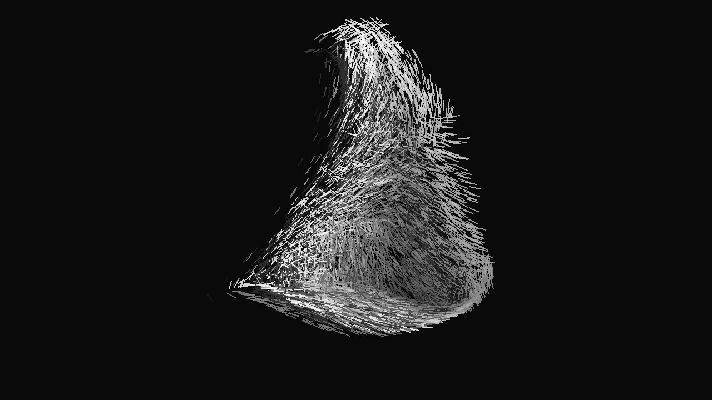
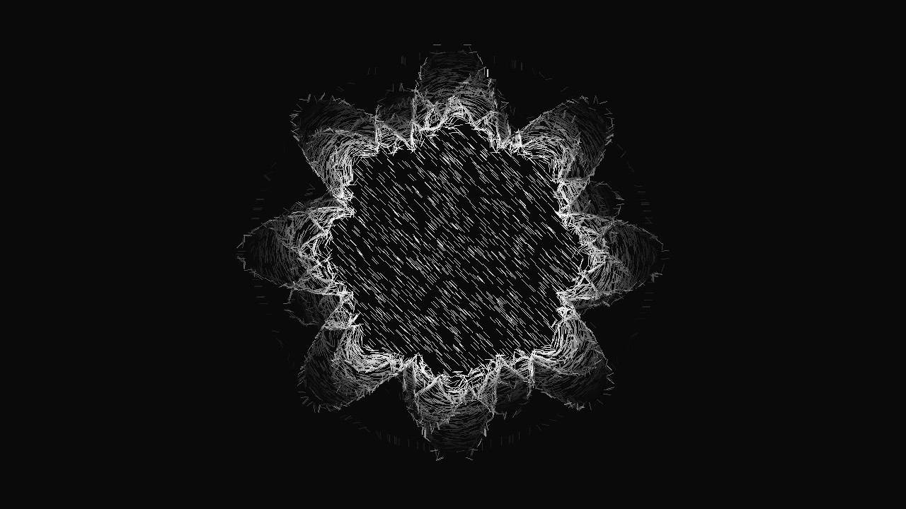
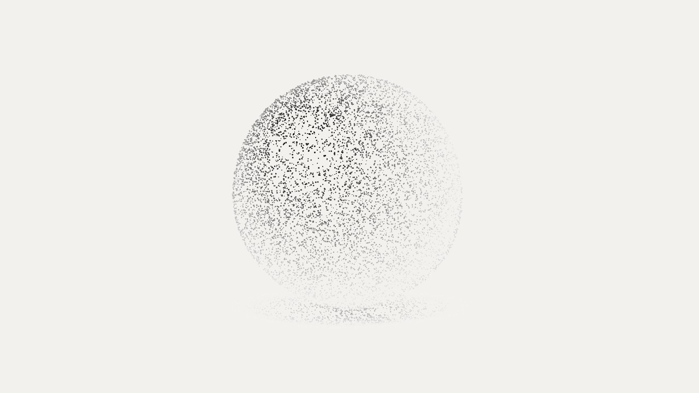
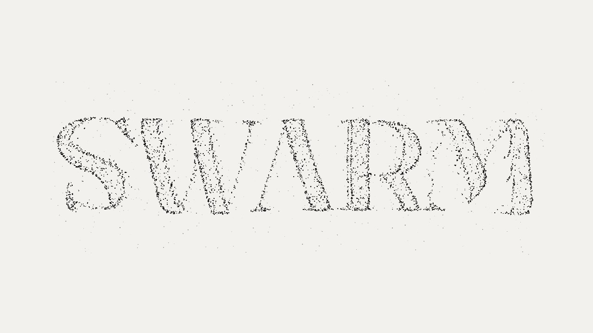

# Swarm

**Images become motion.** Drop in up to four pictures, type a word, or switch on your webcam, and watch them turn into a living swarm of particles. Rotate the result in 3D, give it real depth with an on-device AI model, let it react to music.

**▶ Live demo: https://bernhardbrugger.github.io/swarm/**

Everything runs in your browser. There is no server, no account and no upload.



| | |
|---|---|
|  |  |
|  | |

## What it does

- **Images, text or webcam as the source.** Drag up to four images onto the page (or paste them). Type a word to turn text into particles. Or press `C` for a live webcam swarm whose particles flock to edges and moving parts.
- **Four effects.** *Gather* (the picture dissolves and re-assembles), *Drift* (it flows but stays readable), *Splash* (it bursts and returns), *Depth* (it sways gently in 3D).
- **Real 3D.** Drag to rotate with inertia, mouse wheel to zoom, double-click to reset, *Spin* for a turntable. Brightness acts as relief, or switch *Depth from → AI model* for proper depth.
- **Five ways to draw.** Dots, trails, marks (strokes that follow the edges of the picture), a mesh that connects neighbours, and a scanning light.
- **Black or white.** The same picture as light dots on black, or as dark dots on white. Grayscale by default, original colors optional.
- **Tone controls.** Contrast, brightness, levels (posterize), invert, and *Stipple*, which turns tone into dot density.
- **Sound reactive.** Use the microphone or an audio file: bass makes the dots pulse and sends shock waves through the swarm.
- **Auto director and Shuffle.** Let it pick a new look every few seconds, or roll a random combination.
- **Export.** Save the current frame as PNG or record the animation as WebM.

## Controls

| Input | Action |
|---|---|
| Drag | Rotate in 3D |
| Mouse wheel | Zoom |
| Click | Burst |
| Double-click | Reset the view |
| `1` `2` `3` `4` | Gather, Drift, Splash, Depth |
| `C` | Webcam on/off |
| `A` | Auto director |
| `R` | Shuffle |
| `H` | Hide the controls |
| `F` | Show the frame rate |

## Run it locally

It is a single static file. Either open `index.html` in a browser, or serve the folder:

```bash
python -m http.server 8000
# then open http://localhost:8000
```

The webcam and microphone need a secure context, so use the live demo or `localhost` for those.

## How it works

- **Sampling.** Each image is analysed once: an edge map decides where particles are most useful, and up to 20,000 points are drawn from it by importance sampling. Every point remembers its position, color and the direction of the edge it sits on.
- **Simulation.** Particles are springs chasing their target pixel, plus a disorder force (outward flight, a curl-like flow, or gravity) that is blended in and out. The flow field is evaluated on a coarse grid once per frame, which keeps 20,000 particles cheap.
- **Rendering.** Plain WebGL 1: points for dots, lines for marks and the mesh. Trails fade the previous frame. A grid hash finds neighbours for the mesh. The WebGL context is rebuilt automatically if the browser resets the graphics.
- **Depth.** The default depth is blurred brightness. The AI option runs [Depth Anything V2 Small](https://huggingface.co/onnx-community/depth-anything-v2-small) (Apache-2.0) through [Transformers.js](https://github.com/huggingface/transformers.js) in a web worker. The model (about 27 MB) is downloaded once from the Hugging Face hub and cached by the browser. Your images never leave your computer.
- **Webcam.** The camera frame is downscaled to 192 px wide and re-analysed whenever the camera delivers a new picture. Particles on dull pixels are gradually re-targeted to edges and motion.
- **Self-tuning.** If the frame rate stays low, the app lowers the particle count and then the render resolution on its own. If the very first image takes long to analyse, it starts in a light mode.

## Privacy

No analytics, no tracking, no uploads. Images, webcam and microphone are processed locally. The only network requests are the web fonts from Google Fonts and, if you choose *AI model*, the depth model and its runtime from jsDelivr and Hugging Face.

## Troubleshooting

If something feels slow or freezes, open [`check.html`](check.html) ([live](https://bernhardbrugger.github.io/swarm/check.html)). It measures JavaScript speed, whether graphics are hardware accelerated, canvas read-back speed and network reachability, and lets you copy the result into a bug report.

## Browser support

Any current Chrome, Edge, Firefox or Safari with WebGL. The webcam needs `getUserMedia`; the AI depth needs WebAssembly and workers.

## Credits

- Idea inspired by [Gather 聚 Lite](https://gather.be-of-dao.com) by DAO. Swarm is an independent implementation with its own code and design; it is not affiliated with or endorsed by them.
- [Depth Anything V2](https://github.com/DepthAnything/Depth-Anything-V2) (Apache-2.0) and [Transformers.js](https://github.com/huggingface/transformers.js) (Apache-2.0).
- Fonts via Google Fonts: Unbounded, DM Mono and Fraunces (SIL Open Font License).

## License

[MIT](LICENSE)
